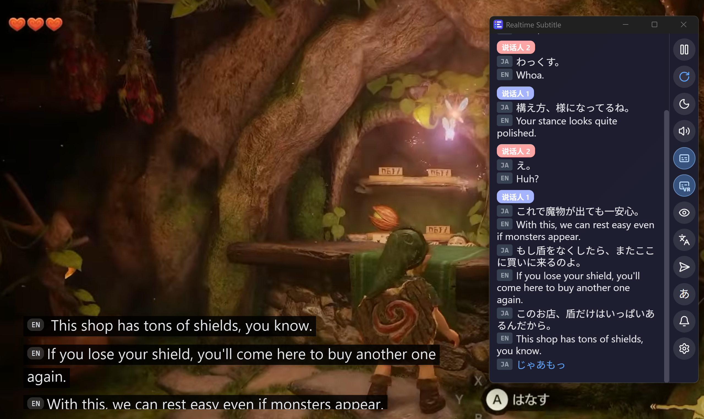

<div align="center">

English · [简体中文](README.zh-CN.md)

</div>

# Realtime Subtitle

A real-time **streaming** speech translator for whatever is playing on your PC, such as a game, a video call, or a stream.

Most subtitle tools wait for a sentence to end before translating it. Realtime Subtitle translates as the words come in: the translation appears while the speaker is still mid-sentence and keeps revising itself as more words arrive, so you can follow along with almost no delay.

Realtime Subtitle captures desktop audio, a single application window, your microphone, or a mix of them, and turns it into live transcripts and translations. Recognition can run **entirely on your own GPU** with no API key, or through a cloud speech API (**Soniox** or **Gemini**) with your own key. An optional LLM pass can polish each finished sentence.

Subtitles can be shown in the main window, a desktop overlay, or a SteamVR overlay. VRChat players also get dedicated features, such as sending translations straight to the VRChat chatbox over OSC.

<div align="center">
    
</div>

## Features

**Streaming translation**

- Original text and translation both update live, word by word, instead of appearing only after each sentence ends.
- On the local provider, translation uses [Hy-MT2-StreamRevise](https://huggingface.co/febilly/Hy-MT2-1.8B-StreamRevise-v4-GGUF), our own fine-tune of Hy-MT2 trained to translate unfinished sentences and revise its own output as the sentence grows.
- In Hybrid mode, the streaming translation is shown immediately and an LLM's polished version replaces it once the sentence is complete.

**Speech recognition and translation**

- Three providers, switchable at runtime from Settings:
  - **Local**: Qwen3-ASR (1.7B, GGUF) for recognition and our fine-tuned Hy-MT2 (1.8B) for translation, both running on your GPU through llama.cpp (Vulkan). Free, offline after the first download, no API key.
  - **Soniox**: real-time speech-to-text plus translation, with speaker diarization.
  - **Gemini**: Gemini Live translation, covering more target languages.
- One-way translation into a chosen language (your system language by default) or two-way translation between two languages.
- Translation modes when an LLM is configured: **Fast** (the provider's or local model's own translation), **Accurate** (LLM translation only), and **Hybrid** (show the fast translation immediately, then replace it with the LLM's improved version).
- Any OpenAI-compatible endpoint works as the LLM (OpenRouter, Cerebras, DeepSeek, a local server, and so on).

**Audio input**

- Capture an output device, a single application window (Windows build 20348+ / Windows 11), a microphone, or desktop audio and microphone mixed together.
- Optional Twitch livestream input (via streamlink and ffmpeg).
- Sleep on silence: the cloud stream closes during long silences and reopens when speech returns, so you don't pay for dead air.

**Display**

- Main window with original text, translation, or both, plus optional speaker labels.
- Always-on-top, semi-transparent desktop subtitle overlay.
- SteamVR subtitle overlay with three position modes (fixed in the world, follow head, follow body), grab-to-move and resize with the controller.
- Furigana for Japanese, bundled Noto Sans CJK font option, light and dark themes, and a UI in many languages.
- Segmentation by sentence punctuation, endpoint, or translation boundary.

**VRChat**

- Send subtitles to the VRChat chatbox over OSC (OSCQuery supported). "Smart" mode sends the translation, or the original text when it's already in the target language.
- Optional sensitive-word filter for outgoing chatbox text only.
- Microphone capture mutes automatically while you're muted in VRChat.
- Rejoins sentences that another speaker briefly interrupted with a filler like "uh-huh", which is common in busy VRChat rooms (Soniox).

<!-- TODO screenshot: settings panel (provider, translation mode) -->
<!-- TODO screenshot: desktop subtitle overlay over a game or video -->
<!-- TODO screenshot: SteamVR overlay in headset -->

## Getting started

### Download

Grab `RealtimeSubtitle.exe` from the [Releases](https://github.com/febilly/realtime-subtitle/releases) page. Releases are built automatically by GitHub Actions from this repository's `main` branch.

### Run from source

```bash
git clone https://github.com/febilly/realtime-subtitle
cd realtime-subtitle
pip install -r requirements.txt
python server.py
```

Add `--debug` to enable WebView devtools and network logging. `python server.py --help` lists all command-line options. On Linux, see [LINUX_SETUP.md](LINUX_SETUP.md) for the extra GUI dependencies.

### First launch

Open **Settings** (the gear button) and pick a provider:

- **Local**: the app offers to download the models the first time (Qwen3-ASR about 2.1 GB VRAM while loaded, Hy-MT2 about 1.3 GB). Downloads come from Hugging Face, with a mirror fallback. You can also download just the recognition model and translate with a cloud LLM instead.
- **Soniox** or **Gemini**: paste your API key. Get one from the [Soniox console](https://console.soniox.com/) or [Google AI Studio](https://aistudio.google.com/apikey).

Then pick your audio source with the audio button and your target language with the translation button.

<!-- TODO screenshot: local model download dialog -->

## Configuration

Settings changed in the app are saved in the app's browser storage and apply immediately; no restart and no file editing is needed. Environment variables (or a `.env` file next to the app) are only read as defaults when nothing has been set in the app. See [`.env.example`](.env.example) for every variable and its default.

### Provider and API keys

```env
TRANSLATION_PROVIDER="soniox"   # soniox | gemini | local
SONIOX_API_KEY="<your-key>"
GEMINI_API_KEY="<your-key>"
```

If `TRANSLATION_PROVIDER` is not set, the app uses whichever provider already has a key, falling back to Soniox. For Soniox you can also choose the API region (United States, European Union, or Japan) in Settings.

### Audio sources

Desktop audio and microphone capture can be enabled independently or mixed. Desktop audio can come from an output device or from one application window. Window capture uses Windows application loopback and captures that application's whole process tree; individual browser tabs can't be isolated. If the window closes, desktop capture goes silent instead of falling back to other apps.

The audio and translation panels each have a **Remember my settings** switch. A remembered window is restored only when its executable and title match exactly one open window.

### LLM translation

Set an OpenAI-compatible endpoint to unlock the Accurate and Hybrid translation modes and the refine button:

```env
LLM_BASE_URL="https://openrouter.ai/api/v1"
LLM_API_KEY="<your-key>"
LLM_MODEL="openai/gpt-oss-120b"
LLM_TEMPERATURE="0.2"
```

`LLM_REQUEST_JSON` and `LLM_REQUEST_HEADERS` let you pass provider-specific options, for example to disable thinking on reasoning models.

<details>
<summary>More options</summary>

### Silence sleep

On by default. Tune it with:

```env
SLEEP_ON_SILENCE="True"
SLEEP_IDLE_SECONDS="30"
SLEEP_PRE_ROLL_SECONDS="0.45"
SLEEP_WAKE_SPEECH_SECONDS="0.65"
SLEEP_WAKE_VAD_THRESHOLD="0.6"
```

The app keeps listening locally while asleep and replays a short pre-roll buffer when it wakes, so the first words aren't lost.

### VRChat OSC

```env
OSC_SEND_TEXT_MODE="smart"               # smart | translation_only | source_only
MUTE_MIC_WHEN_VRCHAT_SELF_MUTED="True"
```

### Speaker labels

```env
HIDE_SPEAKER_LABELS="True"
```

This only hides the labels in the UI. Diarization keeps running, so different speakers are still less likely to be merged into one sentence.

### Twitch input

```env
USE_TWITCH_AUDIO_STREAM="True"
TWITCH_CHANNEL="<channel-name>"
FFMPEG_PATH="ffmpeg"
```

Requires `streamlink` and `ffmpeg`.

### Transcript logging

Off by default. `ENABLE_TRANSCRIPT_LOG="True"` writes transcripts to the `logs/` folder.

</details>

## Tips

- The interface is a web page, so `Ctrl + mouse wheel` (or `Ctrl` + `+` / `-`) changes the text size.
- Hover over any button to see what it does.

## Hosted edition

Besides the open-source build above, there is a separately distributed hosted edition of the same client. Instead of entering an API key, you sign in with your VRChat account and the app connects to a hosted relay that provides Soniox, Gemini, and LLM translation for you. Usage is paid with credits, with a recurring free quota. The hosted edition can still switch to "own key" mode and behaves exactly like the open-source build there.

The builds published on this repository's Releases page are the open-source edition. They contain no server address and never connect to the hosted service.

## Building

```bash
pip install pyinstaller
python build_exe.py
```

The executable is written to `dist/RealtimeSubtitle.exe`.

### Translation checks before commits

Run `npm install` (or `npm run hooks:install` in an existing checkout) to enable the pre-commit hook that checks the UI translations in `static/i18n.js`. Node.js must be available when committing. `npm run check:i18n` checks the working copy, and `npm test` runs it too.

The hook checks the **staged** `static/i18n.js` against its English table: missing languages or keys, empty strings, placeholder mismatches, unexpected keys, and untranslated English copy block the commit. Intentional shared wording (brand names, natural cognates) is listed in `scripts/check-i18n.js`. After fixing a translation, run `git add static/i18n.js` and commit again.

## License

GNU Affero General Public License v3.0 or later. See [LICENSE](LICENSE).

## Acknowledgements

This project stands on the shoulders of giants. Third-party libraries and their licenses are listed in [ACKNOWLEDGMENTS.md](ACKNOWLEDGMENTS.md). Code and data vendored in this repository (kuromoji.js and its dictionary, Lucide icons, libopus) are listed with their license texts in [THIRD_PARTY_NOTICES.md](THIRD_PARTY_NOTICES.md).
