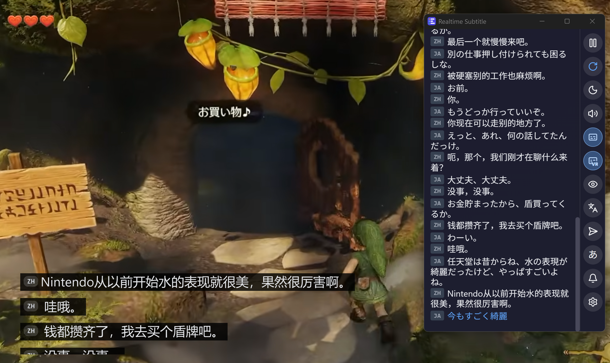

<div align="center">

[English](README.md) · 简体中文

</div>

# Realtime Subtitle

实时**流式**语音翻译器，适用于电脑上正在播放的任何声音，比如游戏、视频通话或直播。

大多数字幕工具要等一句话说完才开始翻译。Realtime Subtitle 边听边译：说话人一句话还没说完，译文就已经出现，并且随着后面的词不断修正，几乎没有延迟。

Realtime Subtitle 可以采集桌面音频、单个应用窗口、麦克风，或者把它们混在一起，实时转写并翻译。识别可以**完全在你自己的显卡上运行**，不需要任何 API key；也可以用你自己的 key 走云端语音 API（**Soniox** 或 **Gemini**）。另外还可以选择用 LLM 对每句说完的话再润色一遍。

字幕可以显示在主窗口、桌面悬浮窗或 SteamVR 悬浮层里。VRChat 玩家还有专属功能，比如通过 OSC 把翻译直接发到 VRChat 聊天框。

<div align="center">
    
</div>

## 功能

**流式翻译**

- 原文和译文都逐词实时更新，而不是每句说完才出现。
- 本地模式下翻译使用 [Hy-MT2-StreamRevise](https://huggingface.co/febilly/Hy-MT2-1.8B-StreamRevise-v4-GGUF)，这是我们自己在 Hy-MT2 基础上微调的模型，能翻译还没说完的句子，并随着句子变长修正自己之前的译文。
- 混合模式下先立即显示流式译文，整句说完后再换成 LLM 润色过的版本。

**语音识别与翻译**

- 三种服务，可在设置里随时切换：
  - **本地**：识别用 Qwen3-ASR（1.7B，GGUF），翻译用我们微调过的 Hy-MT2（1.8B），都通过 llama.cpp（Vulkan）在你的显卡上运行。免费，首次下载后可离线使用，不需要 API key。
  - **Soniox**：实时语音转文字加翻译，支持说话人区分。
  - **Gemini**：Gemini Live 翻译，支持的目标语言更多。
- 单向翻译成指定语言（默认是系统语言），或在两种语言之间双向翻译。
- 配置了 LLM 后可选翻译模式：**快速**（服务或本地模型自带的翻译）、**准确**（只用 LLM 翻译）、**混合**（先立即显示快速翻译，再换成 LLM 改进后的版本）。
- LLM 支持任何 OpenAI 兼容接口（OpenRouter、Cerebras、DeepSeek、本地服务等）。

**音频输入**

- 可采集输出设备、单个应用窗口（Windows build 20348+ / Windows 11）、麦克风，或桌面音频与麦克风混合。
- 可选 Twitch 直播作为输入（需要 streamlink 和 ffmpeg）。
- 静音休眠：长时间没人说话时关闭云端连接，有人说话时再重新连上，不为空白时间付费。

**显示**

- 主窗口可显示原文、译文或两者，可选显示说话人标签。
- 置顶、半透明的桌面字幕悬浮窗。
- SteamVR 字幕悬浮层，三种位置模式（固定在世界中、跟随头部、跟随身体），可用手柄抓取移动和调整大小。
- 日语振假名、可选内置 Noto Sans CJK 字体、浅色和深色主题，界面支持多种语言。
- 断句方式可选：按句末标点、按端点检测或按翻译边界。

**VRChat**

- 通过 OSC 把字幕发到 VRChat 聊天框（支持 OSCQuery）。"智能"模式发送译文；原文已经是目标语言时发送原文。
- 可选敏感词过滤，只作用于发到聊天框的文本。
- 你在 VRChat 里闭麦时，麦克风采集自动静音。
- 把被别人用"嗯""对"这类短语气词打断的句子重新接起来，这在嘈杂的 VRChat 房间里很常见（Soniox）。

<!-- TODO 截图：设置面板（服务、翻译模式） -->
<!-- TODO 截图：游戏或视频上方的桌面字幕悬浮窗 -->
<!-- TODO 截图：头显里的 SteamVR 悬浮层 -->

## 开始使用

### 下载

从 [Releases](https://github.com/febilly/realtime-subtitle/releases) 页面下载 `RealtimeSubtitle.exe`。Releases 由 GitHub Actions 从本仓库 `main` 分支自动构建。

### 从源码运行

```bash
git clone https://github.com/febilly/realtime-subtitle
cd realtime-subtitle
pip install -r requirements.txt
python server.py
```

加 `--debug` 可打开 WebView 开发者工具和网络日志。`python server.py --help` 列出所有命令行参数。Linux 用户请看 [LINUX_SETUP.md](docs/LINUX_SETUP.md)，需要额外安装 GUI 依赖。

### 首次启动

打开**设置**（齿轮按钮），选择一种服务：

- **本地**：第一次使用时应用会提示下载模型（Qwen3-ASR 加载后约占 2.1 GB 显存，Hy-MT2 约 1.3 GB）。模型从 Hugging Face 下载，连不上时自动改用镜像。也可以只下载识别模型，翻译交给云端 LLM。
- **Soniox** 或 **Gemini**：粘贴你的 API key。可在 [Soniox 控制台](https://console.soniox.com/) 或 [Google AI Studio](https://aistudio.google.com/apikey) 获取。

然后用音频按钮选择音源，用翻译按钮选择目标语言。

<!-- TODO 截图：本地模型下载弹窗 -->

## 配置

在应用里改的设置保存在应用的浏览器存储中，立即生效，不需要重启或编辑文件。环境变量（或应用旁边的 `.env` 文件）只在应用里没有设置时作为默认值读取。所有变量及默认值见 [`.env.example`](.env.example)。

### 服务与 API key

```env
TRANSLATION_PROVIDER="soniox"   # soniox | gemini | local
SONIOX_API_KEY="<your-key>"
GEMINI_API_KEY="<your-key>"
```

如果没有设置 `TRANSLATION_PROVIDER`，应用会用已经配置了 key 的那个服务，都没有时默认 Soniox。Soniox 还可以在设置里选择 API 区域（美国、欧盟或日本）。

### 音源

桌面音频和麦克风可以分别开启，也可以混合。桌面音频可以来自某个输出设备，也可以来自某一个应用窗口。窗口采集使用 Windows 应用回环，会采集该应用的整个进程树，无法单独采集某个浏览器标签页。窗口关闭后桌面采集会变成静音，不会改为采集其他应用。

音频面板和翻译面板各有一个**记住我的设置**开关。记住的窗口只有在可执行文件和标题能唯一对应一个打开的窗口时才会恢复。

### LLM 翻译

配置一个 OpenAI 兼容接口，即可使用准确、混合模式和润色按钮：

```env
LLM_BASE_URL="https://openrouter.ai/api/v1"
LLM_API_KEY="<your-key>"
LLM_MODEL="openai/gpt-oss-120b"
LLM_TEMPERATURE="0.2"
```

`LLM_REQUEST_JSON` 和 `LLM_REQUEST_HEADERS` 可以传递服务商特有的参数，例如关闭推理模型的思考。

<details>
<summary>更多选项</summary>

### 静音休眠

默认开启。可调参数：

```env
SLEEP_ON_SILENCE="True"
SLEEP_IDLE_SECONDS="30"
SLEEP_PRE_ROLL_SECONDS="0.45"
SLEEP_WAKE_SPEECH_SECONDS="0.65"
SLEEP_WAKE_VAD_THRESHOLD="0.6"
```

休眠时应用仍在本地监听，唤醒时会补发一小段之前缓存的音频，开头的话不会丢。

### VRChat OSC

```env
OSC_SEND_TEXT_MODE="smart"               # smart | translation_only | source_only
MUTE_MIC_WHEN_VRCHAT_SELF_MUTED="True"
```

### 说话人标签

```env
HIDE_SPEAKER_LABELS="True"
```

只是在界面上隐藏标签。说话人区分仍在运行，所以不同人的话仍然不容易被合并成一句。

### Twitch 输入

```env
USE_TWITCH_AUDIO_STREAM="True"
TWITCH_CHANNEL="<channel-name>"
FFMPEG_PATH="ffmpeg"
```

需要 `streamlink` 和 `ffmpeg`。

### 字幕日志

默认关闭。设置 `ENABLE_TRANSCRIPT_LOG="True"` 会把字幕写入 `logs/` 文件夹。

</details>

## 小技巧

- 界面本质上是网页，可以用 `Ctrl + 鼠标滚轮`（或 `Ctrl` + `+` / `-`）调整字号。
- 鼠标悬停在按钮上可以看到它的作用。

## 托管版

除了上面的开源版，还有一个单独分发的托管版客户端。托管版不需要填 API key，用 VRChat 账号登录后，应用会连接到托管的中转服务，由它提供 Soniox、Gemini 和 LLM 翻译。用量通过点数支付，并有周期性免费额度。托管版也可以切换到"自己的 key"模式，此时和开源版完全一样。

本仓库 Releases 页面发布的是开源版，里面不包含任何服务器地址，也不会连接托管服务。

## 构建

```bash
pip install pyinstaller
python packaging/build_exe.py
```

可执行文件输出到 `dist/RealtimeSubtitle.exe`。

### 提交前的翻译检查

运行 `npm install`（已有的仓库可运行 `npm run hooks:install`）启用 pre-commit 钩子，它会检查 `static/i18n.js` 里的界面翻译。提交时需要能调用 Node.js。`npm run check:i18n` 检查工作区，`npm test` 也会运行这项检查。

钩子会把**暂存区**里的 `static/i18n.js` 和英文表对照：缺少语言或键、空字符串、占位符不一致、多余的键、未翻译的英文都会阻止提交。有意相同的措辞（品牌名、自然同源词）列在 `scripts/check-i18n.js` 里。修好翻译后运行 `git add static/i18n.js` 再提交。

## 许可证

GNU Affero General Public License v3.0 或更高版本。见 [LICENSE](LICENSE)。

## 致谢

本项目站在巨人的肩膀上。第三方库及其许可证列在 [ACKNOWLEDGMENTS.md](ACKNOWLEDGMENTS.md)。本仓库内附带的代码和数据（kuromoji.js 及其词典、Lucide 图标、libopus）及其许可证文本列在 [THIRD_PARTY_NOTICES.md](THIRD_PARTY_NOTICES.md)。
